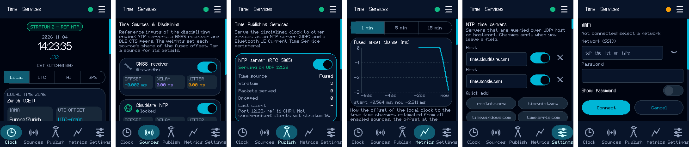

# Arduino-TimeServices

A header-only Arduino library that gathers time from NTP servers, a GNSS receiver and Bluetooth LE peers, combines it into one clock estimate, and serves that time to other devices over NTP and Bluetooth LE (Current Time Service). A touch GUI shows the clock, the sources, the servers and charts.

This is the Arduino port of [Android-Time-Services](https://github.com/pschatzmann/Android-Time-Services). It uses [TinyNTP](https://github.com/pschatzmann/TinyNTP), [TinyCTS](https://github.com/pschatzmann/TinyCTS) and [TinyMaterialDesign](https://github.com/pschatzmann/TinyMaterialDesign).

> **Status:** working prototype, tested on the desktop and on one board (ESP32-S3 2.8" display). See [Important limits](https://github.com/pschatzmann/Arduino-TimeServices/wiki/Important-Limits).



## Highlights

- **Sources:** a configurable list of NTP servers, a GNSS receiver (NMEA, optional PPS) and BLE Current Time Service peers.
- **Fusion:** weighted mean, median or PLL/FLL smoothing with outlier rejection and holdover; optionally sets the clock of the device.
- **Publishing:** an NTP server (UDP) and a BLE Current Time Service peripheral; you choose which source is published.
- **GUI:** Clock, Sources, Publish, Metrics and Settings tabs, and a WiFi page for the network login.
- **Layered:** use only the engine with the sources and servers (no display), or the complete touch GUI.
- **Desktop build** with CMake: the GUI in an SDL2 window with real NTP queries, and the unit tests.

## Documentation

The documentation is in the [project wiki](https://github.com/pschatzmann/Arduino-TimeServices/wiki/Home):

- [User manual](https://github.com/pschatzmann/Arduino-TimeServices/wiki/User-Manual) (a screenshot and description of every tab, the menu and the WiFi page)
- [Features](https://github.com/pschatzmann/Arduino-TimeServices/wiki/Features)
- [Important limits](https://github.com/pschatzmann/Arduino-TimeServices/wiki/Important-Limits)
- [Example: ESP32-S3 2.8" Display](https://github.com/pschatzmann/Arduino-TimeServices/wiki/Example-ESP32-S3-Hosyond)
- [Arduino API](https://github.com/pschatzmann/Arduino-TimeServices/wiki/Arduino-API)
- [Desktop build](https://github.com/pschatzmann/Arduino-TimeServices/wiki/Desktop-Build)
- [Differences to the Android app](https://github.com/pschatzmann/Arduino-TimeServices/wiki/Differences-to-the-Android-App)
- [Project layout](https://github.com/pschatzmann/Arduino-TimeServices/wiki/Project-Layout)

## Install

You can download the library as zip (on GitHub: **Code** → **Download ZIP**) and add it in the Arduino IDE with **Sketch** → **Include Library** → **Add .ZIP Library...**. Or you can git clone this project into the Arduino libraries folder, e.g.

```
cd ~/Documents/Arduino/libraries
git clone https://github.com/pschatzmann/Arduino-TimeServices.git
```

I recommend git, because you can update to the latest version just by executing `git pull` in the project folder.

Install the dependencies the same way:

- [TinyMaterialDesign](https://github.com/pschatzmann/TinyMaterialDesign) and [TinyGPU](https://github.com/pschatzmann/TinyGPU)
- [TinyNTP](https://github.com/pschatzmann/TinyNTP)
- [TinyCTS](https://github.com/pschatzmann/TinyCTS) and, on the ESP32, [NimBLE-Arduino](https://github.com/h2zero/NimBLE-Arduino) (also in the Library Manager): needed only for Bluetooth

## License

[MIT](LICENSE). TinyNTP and TinyCTS are GPL v3: a program built with them is covered by the GPL.
